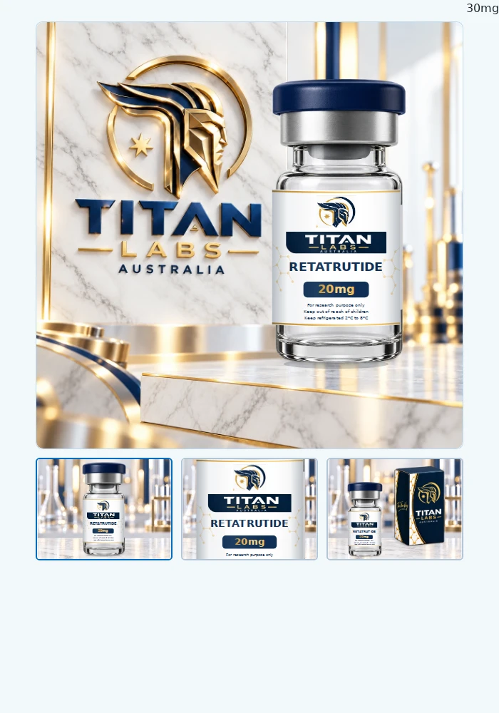
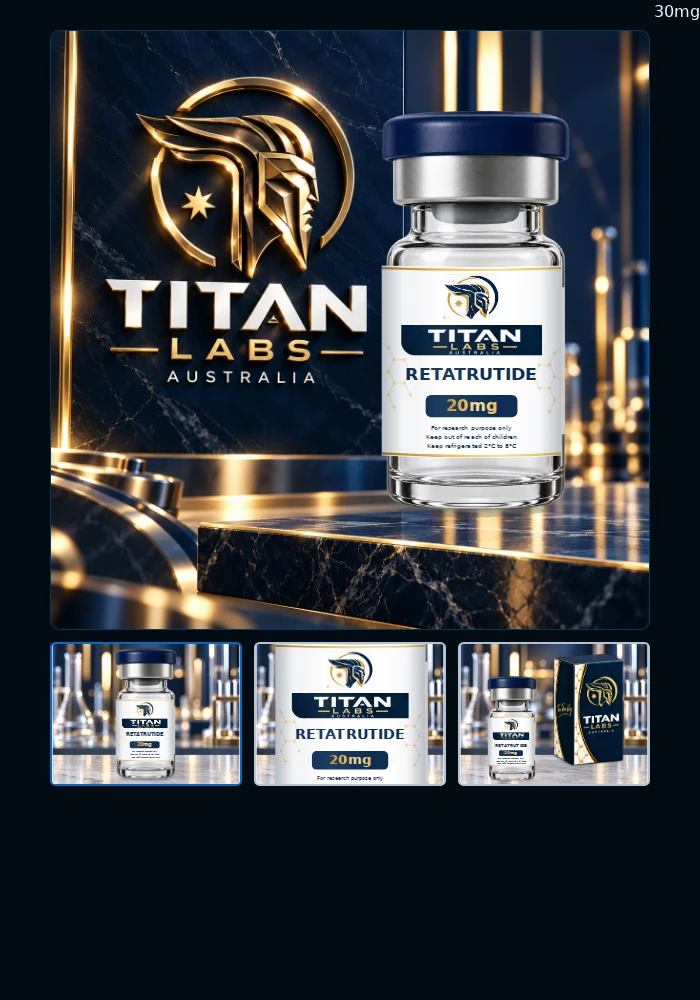

# Titan Range display and gallery review

Owner authorized GitHub merge only. Review and publishing remain with the owner in Lovable.

## Current appearance

- Light mode uses a white marble branded display with navy lettering and champagne-gold accents. Dark mode retains the approved navy/gold display. CSS selects the correct background on first paint using existing theme classes.
- The full-view vial is reduced from a 1000px to a 720px scene scale and its base aligns with the bench surface. A subtle contact shadow anchors it to the bench.
- The tall navy/gold/white label is retained, with the selected product name, quantity and disclaimer facing forward.
- Thumbnails have their own product-focused framing and unbranded photographic backgrounds: full vial, tight on-vial label detail, vial beside its matching carton. Light/dark photographic backgrounds are paired. Large wall branding no longer competes with thumbnail products.
- Range thumbnail captions and the visible active-photo caption are removed. Accessible button names, selected-state announcements and focus controls remain. V2 pen gallery captions and photo rules are unchanged.
- No catalogue data, prices, stock, orders or saved CMS photos were modified.

## Actual gallery component

These screenshots render the production ProductGallery and artwork components with the built production stylesheet in an isolated fixture. They do not represent a live account session. The small 30mg fixture control checks size changes and is not part of the storefront.

## Additional artwork checks

[Light compositions](light.webp) · [Dark compositions](dark.webp) · [Mobile](mobile.webp) · [Long product name](long-name.webp)

The comparison harness labels its separate panels for review; these panel labels are not website thumbnail captions.

## Validation

- TypeScript check: passed.
- Production build using the existing bun.lock: passed; existing framework warnings remain.
- Focused Bun tests: 33 passed, 0 failed (Range data, gallery ownership, theme photo identity, variant images).
- Chromium: actual gallery selections, selected-strength refresh/reset, long names, light/dark rendering and mobile without horizontal overflow or JavaScript errors passed. Actual gallery screenshots confirm captions are absent and thumbnails use separate framing.
- git diff --check: passed.

## Assets

The approved master supplies the actual label helmet and lettering via SVG viewports. Vial and box are photographic mockups with SVG label text driven by product data. Built-in image generation produced a white marble display and bright laboratory plate from the dark references. Prompt intent: preserve display geometry and branding positions, replace dark stone with white marble, use navy lettering and gold trim, keep the foreground empty for compositing. The original dark display is unchanged. These are website visuals, not manufacturing or exact vector logo masters.
