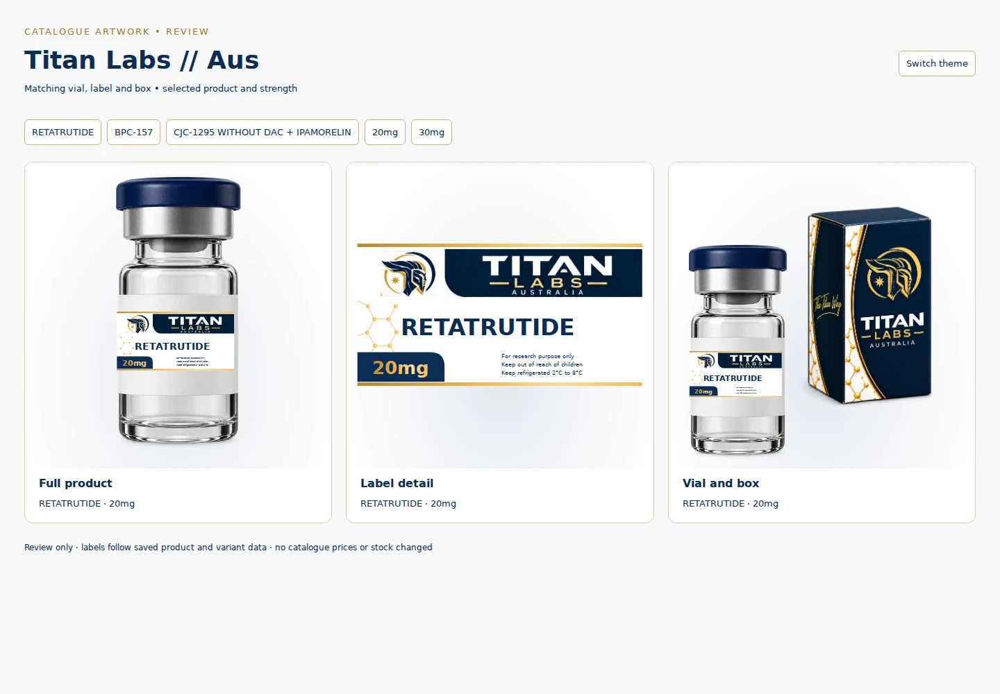
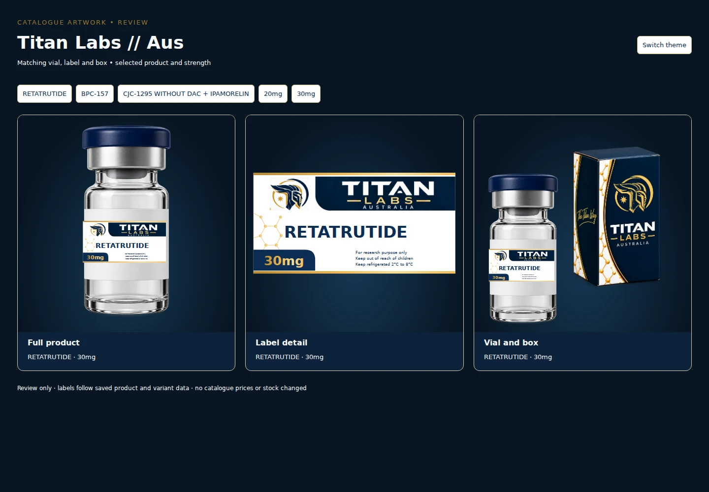

# Matching Titan Labs Range labels and boxes

Display-proportion follow-up to PR #27, based on `review/light-theme` at `eb4b2327624612bf6014d679c07fe82898ebee0c`. Owner requested GitHub merge and will review/publish through Lovable. No deployment is authorized.

## Changes

- All products with primary catalogue section Range use one shared label design. New Range products inherit it automatically.
- Product name and quantity come from the live product and selected variant, including mg, IU, ml and blend labels. Missing strengths stay blank; they are never guessed. Long product names wrap into two lines.
- The label uses the navy/gold helmet and brand lettering directly from the owner's approved reference. The box photograph uses the gold-only helmet, white curved molecular band, navy field and gold detailing.
- The front-facing label now extends from near the glass shoulder to near the base (575px tall on the 1280px vial photo, previously 438px). The larger helmet and wordmark are stacked above the enlarged product name and strength. Curved gold edges and cylindrical shading remain. The disclaimer stays below.
- The full vial is larger and positioned to the right of a new branded navy stone / champagne-gold display backdrop, based on the owner's older blue-and-white display reference. All three views reuse this same updated background.
- Product pages show three selectable photographic thumbnails: Full product, Label detail (close-up on the vial), Titan Labs box. All three share the branded display background and lighting, with theme-aware shading and captions below the thumbnails. Switching size resets the gallery to the full product and refreshes its strength.
- Catalogue cards, homepage Hot Products, related products, cart and checkout thumbnails use the same Range artwork. Pens, Equipment and exact-colour CMS photo rules retain their existing rendering.
- Existing saved Range gallery photos are retained in CMS but ignored by the new coordinated set. No product records, prices, stock, orders, catalogue sections or saved photos were written.

## Visual review

These screenshots render the production artwork component in an isolated review harness, not a screenshot of the signed-in live storefront. The real ProductGallery component was separately exercised in Chromium to verify selection and variant reset.

[Mobile and long-name review](mobile.webp) · [Desktop long-name review](long-name.webp)

## Validation

- `npx tsc --noEmit`: passed.
- Bun focused tests: 33 passed, 0 failed, covering Range data, gallery ownership, theme photo identity and variant photos.
- Chromium: three views render, 20mg → 30mg changes artwork, long-name and light/dark checks, 390px viewport without horizontal overflow, no JavaScript errors.
- Actual ProductGallery component: label and box selections activate the corresponding button; selecting 30mg resets to the full product with 30mg in its accessible label.
- `npm run build`: passed with the repository's existing `bun.lock` dependencies. Existing framework deprecation/chunk-size warnings remain.
- `git diff --check`: passed.

## Asset and rollout notes

The three shared WebP assets total approximately 516 KB, plus the shared branded display background. Vial and box photographs were generated with the built-in image tool; SVG overlays supply accurate product text rather than regenerating every SKU. Prompt intent: isolated clear research vial with blank label and navy cap; isolated approved navy/white/gold carton on transparent background; branded navy/gold stone display background plate, adapted from the owner's older bright-blue vial display screenshot. Reference source: `Gold-Only Helmet Emblems on Navy Boxes(1).png` provided by the owner. The approved master supplies the actual label helmet and wordmark via SVG crops. The box remains a generated photographic interpretation for visual approval, not manufacturing artwork or an exact vector logo master.

Merge into `review/light-theme` as authorized by the owner. The owner controls Lovable review and publishing. No website deployment is included.
